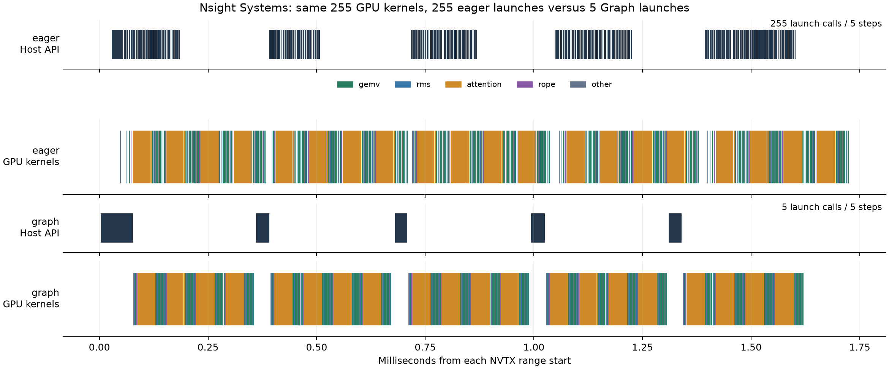

# nano-vLLM-C

用 C11 与 CUDA 实现 Llama 风格推理执行。复用原有 checkpoint mmap、分词器、
采样器、请求调度、分页块引用及前缀复用，在同一执行链路接入手写 CUDA 算子与 Graph。
KV-Fabric 负责外部存储与数据传输；本仓库负责 GPU 常驻 KV 和推理计算。

最新审计：[评测口径与待验收项](docs/PERFORMANCE_AUDIT_20261126.md)、
[冷 L2 / Baseline / 完整步评测入口](benchmarks/audit/README.md)。
已完成独占GPU冷缓存重测与16/16项sanitizer矩阵；16层FP16完整链路采用独立正确性入口完成Racecheck，旧中断/失败记录保留并排除。

历史完整结果：[数值与性能验收](docs/CUDA_VALIDATION.md)、
[阶段交付总结（含双项目简历）](docs/ROUND2_ACCEPTANCE.md)。

## 架构与代码入口

```text
src/main.c / engine.c      C11 CLI、调度、前缀复用、抢占重算、CPU/CUDA 显式分支
src/model.c               原 CPU 前向、legacy FP32 checkpoint mmap
src/cache.c               原有块 ID、引用计数、空闲页 LRU 和前缀哈希链
src/cuda_runtime.c        C11 GPU 权重/缓冲区、页指针表、Decode Step、Graph
src/operators/            SGEMV、RMSNorm、Paged Attention、RoPE、SwiGLU 等 CUDA
include/nv_cuda.h         Host 所有权和 Device buffer 分离的扁平 C 结构
include/nv_attention.h    Paged Attention 的薄 C ABI 和设备数据布局
benchmarks/round2/        独立 FP64 参考、随机测试、计时、NCU/Nsys 分析
benchmarks/operators/     三算子原始基准和验收数据
```

调用链：`nv_engine_step → nv_cuda_forward → nv_cuda_step`。

```text
Embedding → RMSNorm → QKV SGEMV → RoPE + Paged KV Store
          → Paged Decode Attention → O SGEMV + Residual
          → RMSNorm → Gate/Up SGEMV → SwiGLU → Down SGEMV + Residual
          → 重复层 → Final RMSNorm → Classifier SGEMV → CPU Sampling
```

Host 仍为 C11；CUDA `.cu` 只暴露 C ABI。无 class、RAII、虚函数、vtable 或 ctx
分发层。第一轮两个算子从 MiniInfer-C 迁入，保留 `mi_*` C ABI；未复制其存储实现。

## 页布局与 Graph

CPU 调度器继续使用 `block_table[logical] → physical_id` 和现有页引用/LRU。
GPU 每个物理块独立分配，包含全部层；每层页载荷为 `[K/V, token, kv_head, dim]`，
设备页指针表允许物理页不连续。完整前缀只读共享，当前写入页须独占。
启用 CUDA 后释放未使用的 CPU KV 张量，保留其块管理元数据。

Decode Step 只读设备 token、seq_len 和 Block Table；shape、页池和地址固定。
所有显存分配、页表准备及 pinned 元数据上传均在捕获外；上传事件保护 staging，
同一 stream 保证 KV 写入先于 Attention。Graph 内只有 Kernel/Memset。
CPU 采样需要 logits 回读，发生在 Graph 外。改变 batch/模型形状/容量需重新实例化。

## 三个核心算子

| 算子 | 组织与复用 | 适用边界 |
| --- | --- | --- |
| SGEMV | 4 warps/CTA、1 warp/row，向量化 W/X，shuffle 归约 | 低 batch Decode；高 batch 用复用 W 的 GEMM 更合适 |
| RMSNorm | 256 threads/row，输入驻留寄存器，warp/shared 归约和向量读写 | hidden 1..16384；处理非对齐、奇数尾部及平方和溢出 |
| Paged Attention | warp/head/split，64-token 分段 Online Softmax；256-thread 合并 CTA 共享权重 | MHA/GQA/MQA、非连续页、partial tail；D≤256、容量≤65536 |

FP32/FP16/BF16 均 FP32 累加；向量地址不对齐时在同一 Kernel 内安全标量访问。
RoPE 使用原模型的邻接对形式，支持原有 legacy llama2.c FP32 checkpoint，
加载后可转为 FP16/BF16；不直接加载 safetensors/GGUF/Qwen 权重。

## 冷L2实测与验收

RTX4060 Laptop，24 SM/CC8.9，L2 **33,554,432 bytes（32 MiB）**；Driver615.71.09、CUDA13.4、cuBLAS13.8。未锁频，进程/频率/温度快照随结果保存；测量期间无其他CUDA计算任务。

每次算子调用前同stream驱逐128MiB，flush不计时。以下来自本轮100样本真实实测；P50/P95与完整Baseline见[审计报告](docs/PERFORMANCE_AUDIT_20261126.md)。

| Attention精度 | 形状 | 未分段P50 µs | 分段P50 µs | 加速比 |
| --- | --- | --- | --- | --- |
| f32 | B1/H16/KV4/D128/S4096 | 2917.54 | 120.83 | 24.15× |
| f16 | B2/H16/KV4/D128/S32768 | 23314.43 | 1168.38 | 19.95× |
| bf16 | B2/H16/KV4/D128/S32768 | 23196.67 | 1161.22 | 19.98× |

FP32原形状热缓存P50 73.73 µs，驱逐后120.83 µs；NCU热DRAM读取0、冷约16MiB，确认L2影响。低精度B2实际长度[32768,32765]，唯一KV约127.994MiB。基线是自有每head一warp未分段实现；新增向量未分段消融与分段核分别对照，不能称为成熟库比较。

| 冷缓存对照 | Baseline P50 µs | 优化 P50 µs | 结论 |
| --- | --- | --- | --- |
| RMSNorm FP32 128×4096 | 25.60 | 18.43 | 1.39×；标量重读X→向量/寄存器驻留 |
| GEMV FP32 8192×4096/B1，W128MiB | 558.08（cuBLAS） | 620.54 | 本实现仍慢于cuBLAS，不声称超越 |
| 16层d1024随机模型FP16完整GPU greedy步 | 2735.13 | 2622.72 | 4.11%降低；含metadata H2D/Token回传 |

完整步固定B1/seq129，不含CPU页管理/调度或文本输出，非训练模型生成TPS。Graph对照双方预热20次，100组成对交错、交替先后采样。

独立NCU：FP16 Attention partition DRAM 63.69%、132.75 GiB/s、Occupancy 79.54%；FP32 GEMV DRAM 96.72%、230.37 GiB/s。有效带宽与真实DRAM带宽分开，partition不能代表整条Attention。

8/8 CTest，16/16项Memcheck/Racecheck矩阵零错误；16层FP16使用完整模型的独立正确性入口完成Racecheck，保留5步动态Graph和1677万KV槽校验。CPU FP64逐输出/逐物理KV槽在已验收范围容差内零失败。**16层BF16动态前向超出既定容差，已保留失败并排除性能结论；没有放宽容差。** 数值零失败与浮点零误差分开表述。

FP16 NSys真实SQLite：每模式5步，255次Kernel提交→5次Graph提交，即每步51→1，GPU仍执行相同51个Kernel。trace是重复计算步，只用于Launch归因。



精确构建/重测/NCU/NSys/sanitizer命令、缓存说明及原始证据见[评测入口](benchmarks/audit/README.md)，[4条简历改写](docs/RESUME_CUDA_AUDITED.md)。

## 构建与一键复现

CPU 仍可 `make && make test`。CUDA 模式需要 CMake 3.18+、CUDA Toolkit 和 Python 3。
本机架构为 89，其他卡通过 `NV_CUDA_ARCH` 指定兼容架构。

```sh
# 全量构建、8 项 CTest、Memcheck/Racecheck、Attention 和 Decode 基准
bash tools/validate_cuda.sh build-cuda benchmarks/operators/runs/new-run

# 加上 NCU 和 Nsys：需要本机已开放对应性能计数器权限，无需脚本内sudo
bash tools/validate_cuda.sh build-cuda benchmarks/operators/runs/profile-run --profile
```

验收数据在 `benchmarks/operators/round2-results/`。公开副本包含实测 CSV、日志、Nsys 统计及 Timeline；
原始 NCU / Nsys 二进制报告与 SQLite 保留本地，可用 `--profile` 重新生成。
详见[公开归档范围](benchmarks/operators/PROFILING_ARTIFACTS.md)。
可选 `analyze_nsys.py ... --plot`
从真实 SQLite 生成 Timeline 图（需 Matplotlib）；官方统计不依赖它。
无 GPU 的 CUDA 测试返回 77/skip，不算 GPU 验收。

## 运行预训练模型

```sh
python3 tools/download.py --model 260k
build-cuda/nanovllm_cuda models/stories260K.bin -z models/tok512.bin \
  -i "Once upon a time" -n 32 -t 0 --cuda-graph
python3 benchmarks/round2/verify_pretrained.py build-cuda models benchmarks/operators/runs/pretrained
```

历史验收中真实 260K checkpoint 的 4×32 个 greedy Token 在 CPU/eager/Graph 下严格一致。
FP16/BF16 做数值误差验收，不承诺与 FP32 的生成 Token 相同。
CPU 调度每个 tick 仍串行推进各请求；未实现 GPU 批量 GEMM、并行 Prefill、量化或服务层。
TinyStories 不具备可靠中文问答能力。出处与 MIT 许可证保留于 [third_party/](third_party/README.md)。
